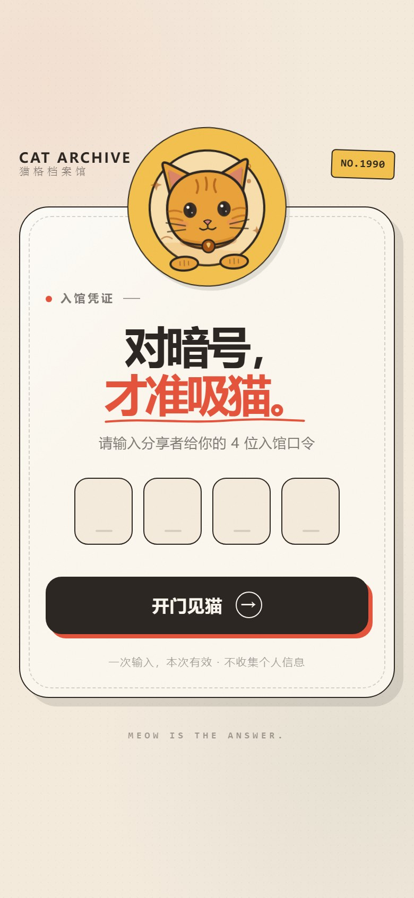
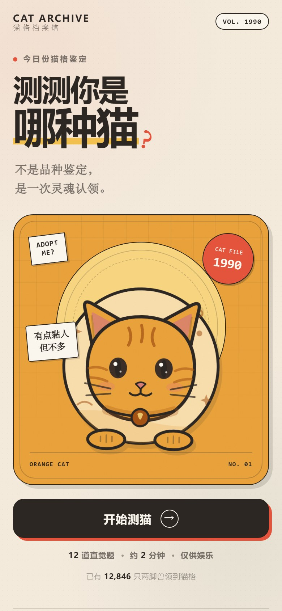
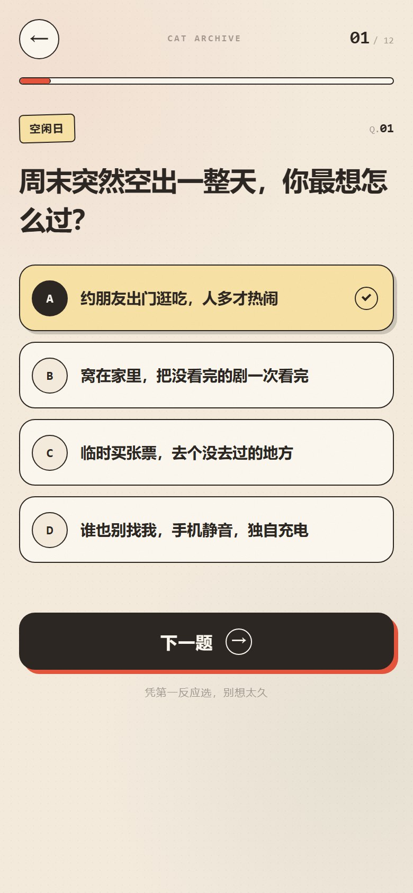
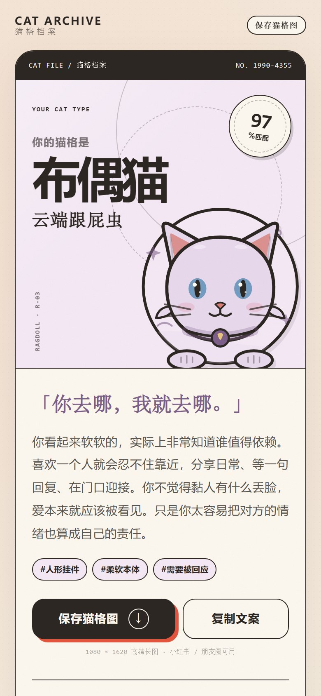
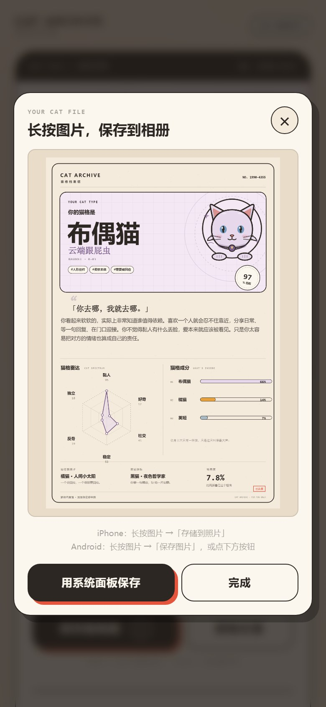

# 猫格档案馆 · 测测你是哪种猫

一个手机优先、纯静态、零依赖的轻量测试页。12 道直觉题，测出 8 种隐藏猫格；结果自动生成 **1080 × 1620 高清长图**，手机可保存到相册。

适合小红书测试类内容：前半段是「对暗号」的口令门，后半段是可直接分享的猫格档案。

| 口令门 | 封面 | 答题 |
| --- | --- | --- |
|  |  |  |

| 结果页 | 保存海报 |
| --- | --- |
|  |  |

[查看完整结果长图](preview/result-full.jpg) · [查看 1080 × 1620 海报原图](preview/poster.jpg)

---

## 现在能做什么

- **口令门**：4 位口令，当前是 `1990`，输对后在当前标签页内有效；刷新不用重复输入，新开浏览器需要重新对暗号。
- **12 道题**：日常场景式单选，可返回上一题修改，也支持键盘 `1`~`4` 和 `Enter`。
- **8 种猫格**：橘猫、黑猫、布偶猫、狸花猫、暹罗猫、英短、奶牛猫、三花猫。
- **结果档案**：匹配度、六维猫格雷达、猫格成分、恋爱说明书、充电方式、超能力 / 盲点、饲养说明书、猫际关系。
- **保存到相册**：生成 1080 × 1620 PNG。
  - 支持系统分享的浏览器（iOS Safari / Android Chrome）点「用系统面板保存」，在系统面板里选「存储图像 / 保存图片」。
  - 不支持时自动下载图片；iOS / 微信内会改为提示长按图片保存，避免浏览器打开 blob 图片后回不来。
  - 弹层里的海报始终可以长按保存，这是最稳的兜底。
- **一键复制文案**：带猫格、匹配度、标签和当前网址，方便直接发小红书。
- **零外部依赖**：没有 CDN、没有字体请求、没有统计脚本，断网也能打开。
- **纯静态部署**：GitHub Pages / Cloudflare Pages 均可，无需构建。

> 口令是前端校验，只能挡住随手点开的人，**不是真正的访问控制**。源码里能直接看到口令。如果要卖「一客一码、防转发」，需要接 Cloudflare Worker 做服务端核销；这个版本没有后端。

---

## 本地预览

```bash
cd cat-archive
python -m http.server 8080
```

浏览器打开 `http://localhost:8080/`。口令：`1990`。

> 建议用本地服务器预览，手机和电脑在同一局域网时可用 `http://电脑IP:8080` 测试真机保存效果。

---

## 目录

```text
cat-archive/
├── index.html          # 页面结构：口令 / 封面 / 答题 / 结算 / 结果 / 海报弹层
├── style.css           # 全部视觉样式与响应式
├── data.js             # ★ 口令、8 种猫格文案、12 道题、计分倾向
├── scoring.js          # 六维归一化、猫格匹配、成分计算
├── art.js              # 8 只猫的 SVG 插画（网页和海报共用）
├── app.js              # 交互、雷达图、Canvas 海报、保存 / 分享 / 复制
├── preview/            # 展示图
├── tools/simulate.cjs  # 随机答题分布测试（开发用，部署可不上传）
├── _headers            # Cloudflare Pages 安全响应头（可删）
├── robots.txt          # 不参与搜索收录
└── .nojekyll           # GitHub Pages 不经过 Jekyll
```

真正需要上传的只有 `index.html`、`style.css`、`data.js`、`scoring.js`、`art.js`、`app.js`。

---

## 怎么改成你自己的

### 1. 改口令

打开 `data.js` 顶部：

```js
const DATA = {
  passcode: '1990',
  // ...
};
```

把 `1990` 改成你想要的 4 位数字即可。输入框限制 4 位，建议保持 4 位数字。

### 2. 改题目 / 结局

都在 `data.js`：

| 想改什么 | 改哪里 |
| --- | --- |
| 六维名称 | `DIMENSIONS` 的 `name` / `low` / `high` |
| 猫格名称、标题、文案 | `TYPES[].name` / `.title` / `.desc` / `.quote` / `.tags` |
| 猫格颜色 | `TYPES[].color` / `.soft` / `.deep` / `.eye` / `.blush` |
| 猫格画像 | `TYPES[].profile`，六个维度各 0~100 |
| 最佳搭子 / 容易误伤 | `TYPES[].best` / `.bestWhy` / `.clash` / `.clashWhy` |
| 稀有度文案 | `TYPES[].rarity` |
| 题目 | `QUESTIONS[].q` / `.options[].text` |
| 选项加分 | `QUESTIONS[].options[].scores`，六个维度 0~3 分 |
| 选项偏向的猫 | `QUESTIONS[].options[].types`，可以写 1~2 只猫 |

改完题目后，建议跑一次分布测试，确认八只猫都有人能测到：

```bash
node tools/simulate.cjs
```

### 3. 换插画 / 配色

- 插画骨架在 `art.js` 的 `catSvg()`，八种猫的差异在 `faceExtras()` 和 `eyes()`。
- 页面主配色在 `style.css` 顶部的 `:root`。
- 海报排版在 `app.js` 的 `buildPoster()`，尺寸是 `1080 × 1620`，坐标按 1080 宽设计。

### 4. 改海报尺寸

`buildPoster()` 里的 `W`、`H` 和各个坐标是按当前 2:3 长图排的。如果只改宽高不改坐标，内容会错位。想改成 3:4（1080 × 1440）需要重新压缩纵向间距。

---

## 部署

### GitHub Pages

1. 把 `cat-archive` 里的文件推到仓库。
2. 仓库 **Settings → Pages → Deploy from a branch**。
3. 选择 `main` / `/(root)`，保存。
4. 打开 `https://<用户名>.github.io/<仓库名>/`。

如果整个仓库根目录还有别的内容，也可以保留 `cat-archive/` 子目录，访问地址就是 `https://<用户名>.github.io/<仓库名>/cat-archive/`。

### Cloudflare Pages

1. Cloudflare Dashboard → Workers & Pages → Create → Pages → Connect to Git。
2. 选择仓库。
3. Framework preset 选 **None**；Build command 留空。
4. 如果仓库根目录就是本站，Build output directory 填 `/`；如果保留子目录，填 `cat-archive`。
5. 点 Deploy，拿到 `https://xxx.pages.dev`。

> 项目已经带 `.nojekyll` 和 `_headers`，GitHub Pages / Cloudflare Pages 都能直接用。**没有构建步骤，不要运行 npm build。**

---

## 保存图片的实际情况

不同浏览器对「网页直接写入相册」的支持不一样，所以这里用了三层兜底：

1. **系统分享**：能分享文件的浏览器，点按钮打开系统面板，选择「存储图像 / 保存图片」。
2. **下载**：不支持系统分享时，自动下载 PNG，再到相册 / 下载目录查看。
3. **长按**：弹层里始终显示完整海报，iPhone 长按选「存储到照片」，Android 长按选「保存图片」，微信里同样长按。

因此，**即使某个浏览器不支持一键写入相册，也一定能通过长按保存**。

海报是 1080 × 1620 PNG，文字和雷达图都是 Canvas 现场绘制的，不依赖 html2canvas 之类的第三方库。

---

## 兼容性

- iOS Safari 15+、Android Chrome / 微信内置浏览器、桌面 Chrome / Edge / Safari。
- 使用系统字体，不请求外部字体。
- 支持 `prefers-reduced-motion`：关闭动画后仍可正常答题和保存。
- 页面禁止搜索引擎收录（`meta robots` + `robots.txt`），但分享链接仍可正常打开。

---

## 口令说明（重要）

`1990` 写在前端 `data.js` 里，任何人查看源码都能找到。它的作用是：

- 让拿到链接的人先对一次暗号，增加一点仪式感；
- 避免链接被随手转发后立刻被打开。

它**不能**防止：

- 懂技术的人直接看源码；
- 把口令告诉别人；
- 绕过前端直接打开结果页（所有逻辑都在浏览器里）。

如果后续要按份售卖，建议保留现在的静态页作为展示，另加一个 Cloudflare Worker 做「一码一设备」的服务端核销。当前页面没有预留接口，需要再加一层。

---

## 内容说明

题目、猫格文案、插画和海报设计都是为本项目单独写的，没有使用第三方测试题库或外部素材。字体使用设备系统字体。
